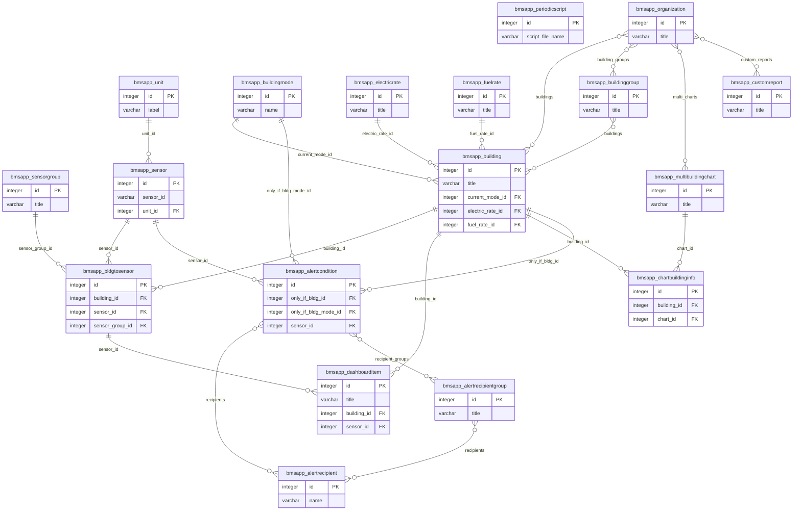

# The Django Database (`bmon.sqlite`)

<!-- GENERATED by scripts/make_django_docs.py - do not edit by hand. -->

This database holds BMON's *configuration*: the buildings, the sensors, how sensors are
assigned to buildings, alerts, dashboards and so on. It does **not** hold sensor readings;
those are in the [sensor reading database](reading-db.md).

The tables below belong to BMON's `bmsapp` Django application and are described by
the model classes in BMON's `bmsapp/models.py`. Django names each table
`bmsapp_<model name in lower case>`.

In a DuckDB session started as described in the [README](../README.md), the database is
attached read-only as `bmon`, so a table is referred to as, for example, `bmon.bmsapp_building`:

```sql
SELECT id, title, latitude, longitude FROM bmon.bmsapp_building ORDER BY title;
```

## Things to know

- **Two kinds of sensor ID.** `bmsapp_sensor.id` is an integer row number used only for
  links *within this database*. `bmsapp_sensor.sensor_id` is the text ID (for example
  `A81758FFFE0526D8_temperature`) that names the sensor's table in the reading database and
  appears in BMON's charts and API. Foreign key columns named `sensor_id` in *other* tables
  (such as `bmsapp_bldgtosensor.sensor_id`) hold the integer `bmsapp_sensor.id`.

- **Sensors belong to buildings through `bmsapp_bldgtosensor`.** One sensor can be in several
  buildings (a weather station, for example), and that table also gives the sensor's group
  and sort order within the building. The `sensors` view created by the DuckDB init file
  does this join for you.

- **Many-to-many links** are stored in small link tables, listed at the
  [end of this page](#link-tables).

- **Booleans** are stored as the integers 0 and 1. The few **times** (such as
  `bmsapp_alertcondition.last_notified`) are Unix timestamps; `to_timestamp()` converts them.

- Several text columns hold **YAML** (function parameters, other properties). They need
  to be parsed in Python to be used.

## Entity relationship diagram

Only key columns are shown: the primary key (PK), foreign keys (FK) and the main
identifying column. Full column lists are in the next section. Read `||--o{` as
"one to many" and `}o--o{` as "many to many" (through a link table).



## Tables

### `bmsapp_sensorgroup`

Model class `SensorGroup`. A functional group that the sensor belongs to, e.g. "Weather, Snowmelt System".

| Column | Type | Description |
|---|---|---|
| `id` | integer | Primary key; a row number assigned by Django. |
| `sort_order` | integer | A number that determines the order that Sensor Groups will be presented to the user. |
| `title` | varchar(80) | The diplay name of the Sensor Group. |

### `bmsapp_unit`

Model class `Unit`. A physical unit, e.g. "deg F", "gpm", for a sensor value.

| Column | Type | Description |
|---|---|---|
| `id` | integer | Primary key; a row number assigned by Django. |
| `label` | varchar(20) | The display name of the unit. (Admin label: "Unit Label") |
| `measure_type` | varchar(30) | The type of physical quantity being measured, e.g. temperature, fluid flow, air flow, power. (Admin label: "Measurement Type") |

### `bmsapp_sensor`

Model class `Sensor`. One sensor or a calculated field

| Column | Type | Description |
|---|---|---|
| `id` | integer | Primary key; a row number assigned by Django. |
| `sensor_id` | varchar(80) | Sensor ID, either from Monnit network or a user-entered ID for a calculated value. (Admin label: "Sensor ID, or Calculated Field ID") |
| `title` | varchar(80) | Descriptive title for the sensor, shown to users. |
| `is_calculated` | bool | If True, this field is a calculated field and is not directly created from a sensor. |
| `tran_calc_function` | varchar(80) | The name of the transform function to scale the value, if any, for a standard sensor field, or the calculation function (required) for a calculated field. transform functions must be located in the "transforms.py" module in the "calcs" package and calculated field functions must be properly referenced in the "calc_readings.py" script in the "scripts" directory. (Admin label: "Transform or Calculated Field Function Name") |
| `function_parameters` | text | The function parameters, if any, for the transform or calculation function above. parameters are entered in YAML format. (Admin label: "Function Parameters in YAML form") |
| `calculation_order` | integer | Calculation order. If this particular calculated field depends on the completion of other calculated fields first, make sure the calculation_order for this field is higher than the fields it depends on. |
| `formatting_function` | varchar(50) | The name of the formatting function for the value, if any. Formatting functions must be located in the "formatters.py" module. (Admin label: "Formatting Function Name") |
| `unit_id` | integer | Links to [`bmsapp_unit`](#bmsapp_unit).`id`. The units for the sensor values Does not allow no value. |
| `notes` | text | Adds in a notes field to the Current sensors page. (Admin label: "Please enter descriptive notes about the sensor.") |
| `other_properties` | text | Additional Descriptive Properties to include in the key_properties function. These are given higer priority over the other fields so can be used to override other field values. (Admin label: "Additional Properties to include when exporting data. YAML form, e.g. room: telecom closet") (Help text: "One property per line. Name of Property, a colon, a space, and then the property value.") |
| `latitude` | real | Optional, Latitude of sensor location. Can be NULL. |
| `longitude` | real | Optional, Longitude of sensor location. Can be NULL. |

### `bmsapp_buildingmode`

Model class `BuildingMode`. A state or mode that the building could be in, such as Winter, Summer, Vacant.

| Column | Type | Description |
|---|---|---|
| `id` | integer | Primary key; a row number assigned by Django. |
| `name` | varchar(50) | Name of the mode. (Admin label: "Mode Name") |

### `bmsapp_electricrate`

Model class `ElectricRate`. Defines an electric rate schedule.

| Column | Type | Description |
|---|---|---|
| `id` | integer | Primary key; a row number assigned by Django. |
| `title` | varchar(80) | Name of the Rate Schedule. |
| `sort_order` | integer | Determines the order that the Rate Schedule will be presented in the UI. |
| `customer_charge` | real | Monthly fixed customer charge. (Admin label: "Monthly Fixed Customer Charge, $/month") (Help text: "This charge is assessed every month, irrespective of usage.") |
| `rate1` | real | Energy rate, 1st block. (Admin label: "Rate for first block of usage, $/kWh") |
| `block1` | real | 1st Block size, kWh. (Admin label: "1st Block size in kWh, leave blank to apply to all kWh") (Help text: "Leave this entry blank if there are no usage blocks and the first rate applies to all kWh.") Can be NULL. |
| `rate2` | real | Energy rate, 2nd block. (Admin label: "Rate for second block of usage, if present, $/kWh") (Help text: "Only used if there is a second usage block.") Can be NULL. |
| `demand_charge` | real | Demand Charge. (Admin label: "Demand Charge for maximum 15 minute power, $/kW/mo") (Help text: "Generally not used except for Large Commercial rate structures.") |

### `bmsapp_fuelrate`

Model class `FuelRate`. Defines a fuel rate.

| Column | Type | Description |
|---|---|---|
| `id` | integer | Primary key; a row number assigned by Django. |
| `title` | varchar(80) | Name of the Rate Schedule. |
| `sort_order` | integer | Determines the order that the Rate Schedule will be presented in the UI. |
| `customer_charge` | real | Monthly fixed customer charge. (Admin label: "Monthly Fixed Customer Charge, $/month") (Help text: "This charge is assessed every month, irrespective of usage.") |
| `rate` | real | Fuel price expressed in $/MMBtu. |

### `bmsapp_building`

Model class `Building`. A building that contains sensors.

| Column | Type | Description |
|---|---|---|
| `id` | integer | Primary key; a row number assigned by Django. |
| `title` | varchar(80) | Name of the building displayed to users. |
| `latitude` | real | Latitude of building. |
| `timezone` | varchar(50) | The timezone, from the Olson timezone database, where the facility is located. (Admin label: "Time Zone of Facility, from tz database") |
| `schedule` | text | Occupied schedule for building. No entry means continually occupied. (Admin label: "Occupied Schedule of Facility (e.g. M-F: 8a-5p)") |
| `current_mode_id` | integer | Links to [`bmsapp_buildingmode`](#bmsapp_buildingmode).`id`. Current mode that building is in. (Admin label: "Current Operating Mode") Can be NULL. |
| `report_footer` | text | Descriptive Text that shows at the bottom of the Current Values and Dashboard reports. (Admin label: "Additional Building Documentation") (Help text: "Use <a href="http://markdowntutorial.com/"> markdown syntax </a> to add links, pictures, etc. Note that you <b>must</b> include the url prefix (e.g. <i>http://</i>) in your links.") |
| `timeline_annotations` | text | Timeline annotations. (Admin label: "Annotations for events in the building's timeline (e.g. Boiler Replaced: 1/1/2017)") (Help text: "One annotation per line. Use a colon between the annotation and the date/time.") |
| `other_properties` | text | Additional Descriptive Properties to include in the key_properties function. These are given higer priority over the other fields so can be used to override other field values. (Admin label: "Additional Properties to include when exporting data. YAML form, e.g. age: 23") (Help text: "One property per line. Name of Property, a colon, a space, and then the property value.") |
| `building_type` | varchar(5) | (Admin label: "Building Type") Can be NULL. |
| `co2_sensors` | text | CO2 Sensors. (Admin label: "CO2 Sensor IDs, one per line") |
| `electric_ids` | text | Building Electric Power Sensors. (Admin label: "Building Electric Power Sensor IDs, one per line") (Help text: "Sensors will be added together to determine total electric use.") |
| `floor_area` | real | Floor area of building. (Admin label: "Floor area of Building in square feet") Can be NULL. |
| `fuel_ids` | text | Building Fuel Use Sensors. (Admin label: "Building Fuel Use Sensor IDs, one per line") (Help text: "Sensors will be added together to determine total fuel use.") |
| `indoor_lights` | text | Building Indoor Light Sensors. (Admin label: "Indoor Light Sensor IDs, one per line") |
| `indoor_temps` | text | Building Indoor Temperature Sensors. (Admin label: "Indoor Temperature Sensor IDs, one per line") |
| `outdoor_temp` | varchar(80) | Building outdoor temperature sensor. (Admin label: "Outdoor Temperature Sensor ID") |
| `electric_rate_id` | integer | Links to [`bmsapp_electricrate`](#bmsapp_electricrate).`id`. Electric Rate for Building. (Admin label: "Electric Rate Schedule for Building") Can be NULL. |
| `fuel_rate_id` | integer | Links to [`bmsapp_fuelrate`](#bmsapp_fuelrate).`id`. Fuel Rate for Building. (Admin label: "Primary Fuel Price for Building") Can be NULL. |
| `notes_private` | text | Private Building Notes. (Admin label: "Notes only seen by Sys Admins") (Help text: "Any text is valid and will only be seen by System Administrators.") |
| `longitude` | real | Longitude of building. |

Many-to-many `sensors`: linked to [`bmsapp_sensor`](#bmsapp_sensor) through `bmsapp_bldgtosensor`. The sensors and calculated values associated with this building.

### `bmsapp_buildinggroup`

Model class `BuildingGroup`. Defines a group of buildings that the user can select to filter the buildings shown in the user interface.

| Column | Type | Description |
|---|---|---|
| `id` | integer | Primary key; a row number assigned by Django. |
| `sort_order` | integer | Determines the order that the building group will be presented in the UI. |
| `title` | varchar(80) | Name of the building group. |

Many-to-many `buildings`: linked to [`bmsapp_building`](#bmsapp_building) through `bmsapp_buildinggroup_buildings`. The buildings that are present in this group.

### `bmsapp_bldgtosensor`

Model class `BldgToSensor`. Links buildings to sensors and supplies additional information about what Sensor Group the sensor is in and what order the sensor should be listed within the group. The Bldg-to-Sensor link is set up as Many-to-Many beacause weather station sensors or calculated values can be used by multiple different buildings.

| Column | Type | Description |
|---|---|---|
| `id` | integer | Primary key; a row number assigned by Django. |
| `sort_order` | integer | Within the sensor group, this field determines the sort order of this sensor. |
| `building_id` | integer | Links to [`bmsapp_building`](#bmsapp_building).`id`. The building and sensor that are linked. |
| `sensor_id` | integer | Links to [`bmsapp_sensor`](#bmsapp_sensor).`id`. |
| `sensor_group_id` | integer | Links to [`bmsapp_sensorgroup`](#bmsapp_sensorgroup).`id`. For this building, the sensor group that the sensor should be classified in. The default value is for the "Miscellaneous" Sensor Group. |

### `bmsapp_dashboarditem`

Model class `DashboardItem`. An item on the Dashboard display for a building.

| Column | Type | Description |
|---|---|---|
| `id` | integer | Primary key; a row number assigned by Django. |
| `row_number` | integer | The row number on the Dashboard that this item will appear in. Numbering can start at any value and skip values; only the order matters. |
| `column_number` | integer | The column number on the Dashboard that this item will appear in. Numbering can start at any value and can skip value; only the order matters. |
| `title` | varchar(50) | Title, mostly used for Label widgets, but also overrides default title on other widgets. (Admin label: "Widget Title (can be blank)") Can be NULL. |
| `minimum_normal_value` | real | The range of normal values. |
| `maximum_normal_value` | real |  |
| `minimum_axis_value` | real | The total range of values shown on the Widget. If blank, default axis values will be calculated. Can be NULL. |
| `maximum_axis_value` | real | Can be NULL. |
| `building_id` | integer | Links to [`bmsapp_building`](#bmsapp_building).`id`. The building this Dashboard item is for. |
| `sensor_id` | integer | Links to [`bmsapp_bldgtosensor`](#bmsapp_bldgtosensor).`id`. The sensor, if any, used in this Dashboard item. This is actually a Building-to-Sensor object that contains a reference to a Sensor. Can be NULL. |
| `widget_type` | varchar(15) |  |

### `bmsapp_multibuildingchart`

Model class `MultiBuildingChart`. One particular chart that utilizes data from a group of buildings

| Column | Type | Description |
|---|---|---|
| `id` | integer | Primary key; a row number assigned by Django. |
| `title` | varchar(60) | Descriptive title of the Chart. |
| `chart_class` | varchar(60) | The type of chart. Can be NULL. |
| `sort_order` | integer | Determines order of Chart displayed in Admin interface. |
| `parameters` | text | The general parameters for this chart, if any. These are parameters that are *not* associated with a particular building. The parameters are entered in YAML format. (Admin label: "General Chart Parameters in YAML Form") |

### `bmsapp_chartbuildinginfo`

Model class `ChartBuildingInfo`. Information about a building that is used in an MultiBuildingChart.

| Column | Type | Description |
|---|---|---|
| `id` | integer | Primary key; a row number assigned by Django. |
| `sort_order` | integer | Determines the order that this building appears in the chart. |
| `building_id` | integer | Links to [`bmsapp_building`](#bmsapp_building).`id`. The building participating in the Chart. |
| `chart_id` | integer | Links to [`bmsapp_multibuildingchart`](#bmsapp_multibuildingchart).`id`. The associated chart. |
| `parameters` | text | The parameters for this chart associated with this building, if any. The parameters are entered in YAML format. (Admin label: "Chart Parameters in YAML Form") |

### `bmsapp_alertrecipient`

Model class `AlertRecipient`. A person or entity that is sent a notification when an Alert condition occurs.

| Column | Type | Description |
|---|---|---|
| `id` | integer | Primary key; a row number assigned by Django. |
| `active` | bool | If False, no alerts will be sent to this person. |
| `name` | varchar(50) | Name of recipient. |
| `notify_email` | bool | Email notification fields. (Admin label: "Send Email?") |
| `email_address` | varchar(100) |  |
| `notify_cell` | bool | Cell Phone Text Message notification fields. (Admin label: "Send Text Message?") |
| `cell_number` | varchar(10) | (Admin label: "10 digit Cell number") |
| `cell_sms_gateway` | varchar(60) | (Admin label: "Cell Phone Carrier") |
| `pushover_id` | varchar(30) | (Admin label: "Pushover ID") |
| `notes` | text | Notes about Recipient. |
| `notify_pushover` | bool | Pushover mobile app notification fields. (Admin label: "Send Pushover Notification?") |

### `bmsapp_alertrecipientgroup`

Model class `AlertRecipientGroup`. Defines a group of Alert Recipients. These can be assigned to individual AlertConditions and all of the recipients will be notified.

| Column | Type | Description |
|---|---|---|
| `id` | integer | Primary key; a row number assigned by Django. |
| `title` | varchar(80) | Name of the Alert Recipient group. |
| `notes` | text | Notes about Recipient Group. |

Many-to-many `recipients`: linked to [`bmsapp_alertrecipient`](#bmsapp_alertrecipient) through `bmsapp_alertrecipientgroup_recipients`. The Alert Recipients that are present in this group.

### `bmsapp_alertcondition`

Model class `AlertCondition`. A sensor condition that should trigger an Alert to be sent to AlertRecipient's.

| Column | Type | Description |
|---|---|---|
| `id` | integer | Primary key; a row number assigned by Django. |
| `active` | bool | If False, this condition will not be evaluated. (Help text: "Uncheck the box to Disable the alert.") |
| `condition` | varchar(20) | Conditional type to evaluate for the sensor value. (Admin label: "Notify when the Sensor value is") |
| `test_value` | real | The value to test the current sensor value against. (Admin label: "this value") Can be NULL. |
| `alert_message` | text | Alert message. If left blank a message will be created from other field values. (Help text: "If left blank, a message will be created automatically.") |
| `priority` | varchar(5) | (Admin label: "Priority of this Alert Situation") |
| `wait_before_next` | real | Determines delay before notifying again about this condition. Expressed in hours. (Admin label: "Hours to Wait before Notifying Again") |
| `last_notified` | real | When the last notification of this alert condition was sent out, Unix timestamp. This is filled out when alert conditions are evaluated and is not accessible in the Admin interface. |
| `only_if_bldg_id` | integer | Links to [`bmsapp_building`](#bmsapp_building).`id`. Fields to qualify the condition test according to building mode. (Admin label: "But only if building") Can be NULL. |
| `only_if_bldg_mode_id` | integer | Links to [`bmsapp_buildingmode`](#bmsapp_buildingmode).`id`. (Admin label: "is in this mode") Can be NULL. |
| `sensor_id` | integer | Links to [`bmsapp_sensor`](#bmsapp_sensor).`id`. The sensor this condition applies to. |
| `only_if_bldg_status` | varchar(15) | (Admin label: "and this status") Can be NULL. |
| `last_status` | varchar(255) | The most recent result message for the alert. This is filled out when alert conditions are evaluated and is not accessible in the Admin interface. Can be NULL. |
| `alert_timeout` | real | Determines how many days an alert will be sent if no new sensor readings have arrived. (Admin label: "# of Days to Alert without a Sensor Reading Update") |
| `read_count` | smallint unsigned | (Admin label: "Number of times Condition must occur before alerting") |

Many-to-many `recipients`: linked to [`bmsapp_alertrecipient`](#bmsapp_alertrecipient) through `bmsapp_alertcondition_recipients`. The recipients who should receive this alert. (Admin label: "Who should be notified?")

Many-to-many `recipient_groups`: linked to [`bmsapp_alertrecipientgroup`](#bmsapp_alertrecipientgroup) through `bmsapp_alertcondition_recipient_groups`. The recipient groups who should receive this alert. (Admin label: "Recipient Groups who should be notified")

### `bmsapp_periodicscript`

Model class `PeriodicScript`. Describes a script that should be run on a periodic basis, often for the purposes of collecting sensor readings to store in the reading database.

| Column | Type | Description |
|---|---|---|
| `id` | integer | Primary key; a row number assigned by Django. |
| `script_file_name` | varchar(50) | Name of the script file. (Admin label: "File name of script") |
| `period` | integer | (Admin label: "How often should script run") |
| `script_parameters` | text | Parameters for the script, if any, given in YAML form. (Admin label: "Script Parameters in YAML form") |
| `description` | varchar(80) | Optional Description. |
| `hidden_script_results` | text | Results of the Script that are *not* displayed in the Admin interface. Useful for storing authorization tokens or other credentials. (Admin label: "Hidden Script results in YAML form") |
| `script_results` | text | Results of the script saved and passed to the next invocation of the script. (Admin label: "Script results in YAML form") |

### `bmsapp_customreport`

Model class `CustomReport`. Defines a custom report with text and widgets defined by the user.

| Column | Type | Description |
|---|---|---|
| `id` | integer | Primary key; a row number assigned by Django. |
| `group` | varchar(80) | Name of the group that the report is listed under. |
| `title` | varchar(80) | Name of the report. |
| `sort_order` | integer | Determines the order within the group that the report will be presented in the UI. |
| `markdown_text` | text | Markdown text that defines what will appear in the report. (Admin label: "Report Content (in markdown):") (Help text: "Use <a href="http://markdowntutorial.com/">markdown syntax</a> to add links, pictures, etc. Note that you <b>must</b> include the url prefix (e.g. <i>http://</i>) in any external links.") |

### `bmsapp_organization`

Model class `Organization`. Defines an Organization that the user can use to filter the buildings and building groups shown in the user interface.

| Column | Type | Description |
|---|---|---|
| `id` | integer | Primary key; a row number assigned by Django. |
| `title` | varchar(80) | Name of the Organization. |
| `sort_order` | integer | Determines the order that the Organization will be presented in the UI. |

Many-to-many `buildings`: linked to [`bmsapp_building`](#bmsapp_building) through `bmsapp_organization_buildings`. The buildings that are present in this Organization.

Many-to-many `building_groups`: linked to [`bmsapp_buildinggroup`](#bmsapp_buildinggroup) through `bmsapp_organization_building_groups`. The building groups that are present in this Organization.

Many-to-many `multi_charts`: linked to [`bmsapp_multibuildingchart`](#bmsapp_multibuildingchart) through `bmsapp_organization_multi_charts`. Multi-Building Charts associated with this Organization.

Many-to-many `custom_reports`: linked to [`bmsapp_customreport`](#bmsapp_customreport) through `bmsapp_organization_custom_reports`. Custom Reports associated with this Organization.

## Link tables

Django creates one of these for each many-to-many relationship. Each row links one row
of the first table to one row of the second.

| Link table | Columns | Meaning |
|---|---|---|
| `bmsapp_buildinggroup_buildings` | `id`, `buildinggroup_id`, `building_id` | The `buildings` of a `bmsapp_buildinggroup` row: links it to `bmsapp_building` rows. |
| `bmsapp_alertrecipientgroup_recipients` | `id`, `alertrecipientgroup_id`, `alertrecipient_id` | The `recipients` of a `bmsapp_alertrecipientgroup` row: links it to `bmsapp_alertrecipient` rows. |
| `bmsapp_alertcondition_recipients` | `id`, `alertcondition_id`, `alertrecipient_id` | The `recipients` of a `bmsapp_alertcondition` row: links it to `bmsapp_alertrecipient` rows. |
| `bmsapp_alertcondition_recipient_groups` | `id`, `alertcondition_id`, `alertrecipientgroup_id` | The `recipient_groups` of a `bmsapp_alertcondition` row: links it to `bmsapp_alertrecipientgroup` rows. |
| `bmsapp_organization_buildings` | `id`, `organization_id`, `building_id` | The `buildings` of a `bmsapp_organization` row: links it to `bmsapp_building` rows. |
| `bmsapp_organization_building_groups` | `id`, `organization_id`, `buildinggroup_id` | The `building_groups` of a `bmsapp_organization` row: links it to `bmsapp_buildinggroup` rows. |
| `bmsapp_organization_multi_charts` | `id`, `organization_id`, `multibuildingchart_id` | The `multi_charts` of a `bmsapp_organization` row: links it to `bmsapp_multibuildingchart` rows. |
| `bmsapp_organization_custom_reports` | `id`, `organization_id`, `customreport_id` | The `custom_reports` of a `bmsapp_organization` row: links it to `bmsapp_customreport` rows. |

An example, listing the buildings of each organization:

```sql
SELECT org.title AS organization, bldg.title AS building
FROM bmon.bmsapp_organization AS org
JOIN bmon.bmsapp_organization_buildings AS link ON link.organization_id = org.id
JOIN bmon.bmsapp_building AS bldg ON link.building_id = bldg.id
ORDER BY organization, building;
```

## Other tables in the database

The remaining tables belong to Django itself, not to BMON: `auth_*` (user accounts,
groups and permissions), `django_admin_log` (a history of changes made in the Admin
site), `django_session`, `django_content_type` and `django_migrations`. Note that
`auth_user` holds password hashes and e-mail addresses, and `bmsapp_alertrecipient`
holds phone numbers and e-mail addresses; treat query results from them with care.
